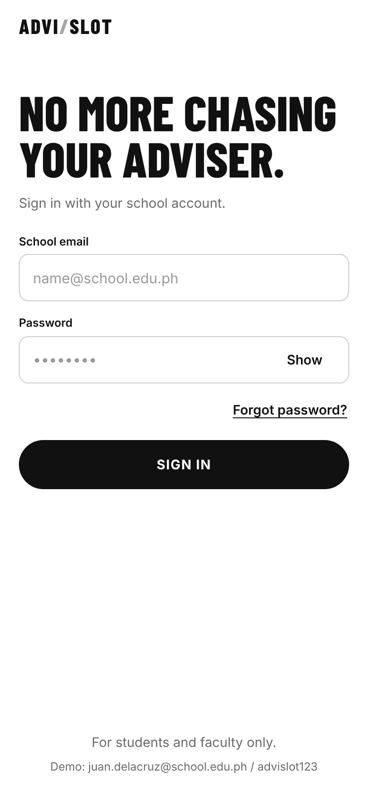
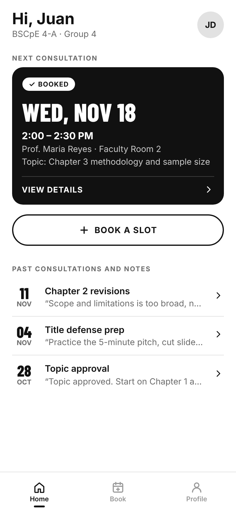
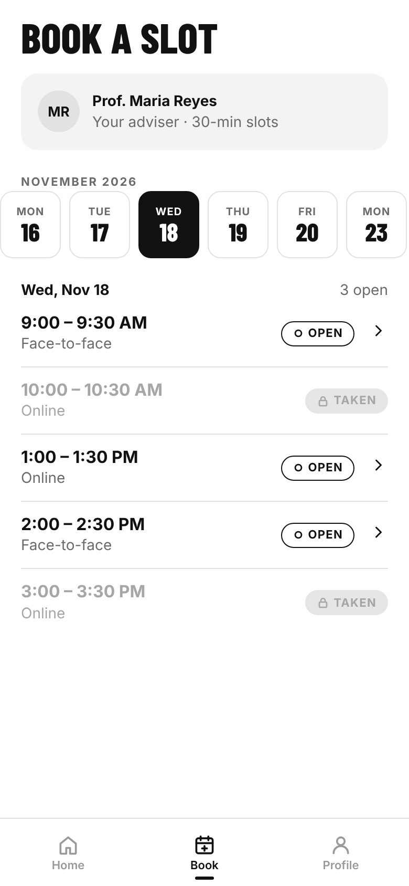
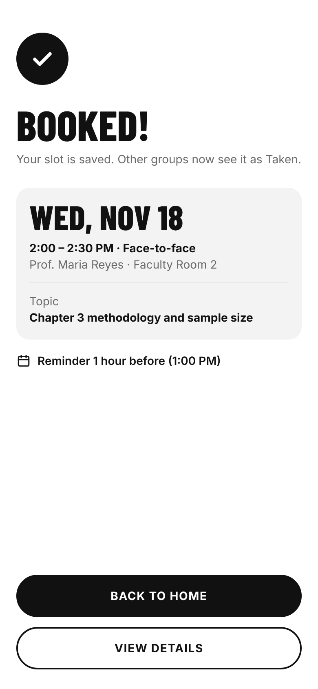
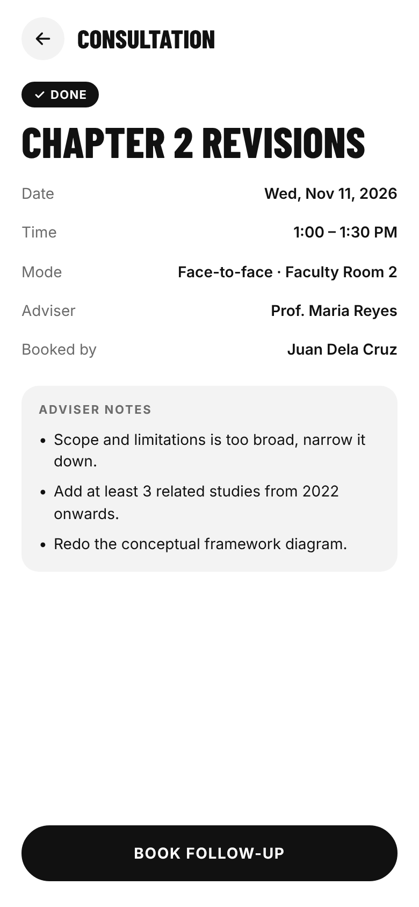
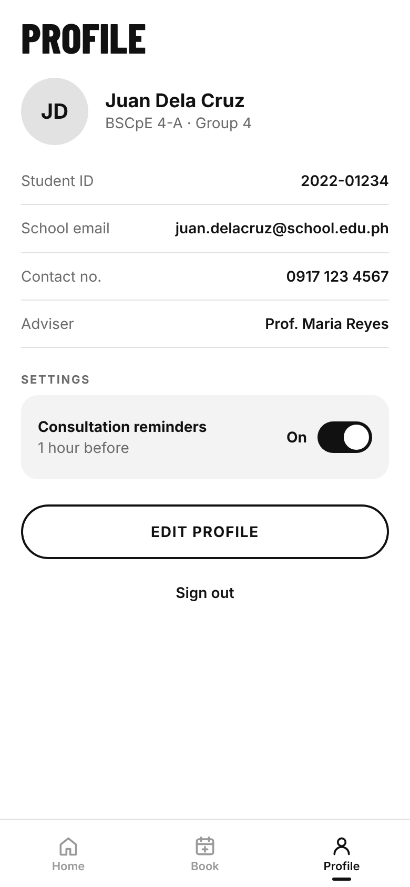

# AdviSlot

Book thesis and capstone consultations with your adviser: advisers post open slots, a group books one with a topic, and the adviser's notes stay in the app for the whole group.

Michael Joseph Tagaan · BSCpE 4-G · Mobile Application Development

**Download:** [AdviSlot.apk](https://github.com/mjtagaan/advislot/releases/latest/download/AdviSlot.apk) (v1.0.0 release)

<p>
  
  
  
</p>
<p>
  
  
  
</p>

## Problem

Capstone students and their advisers have no single place to set consultation schedules and keep the feedback from each session, which leads to late replies, double-booked time slots, and lost consultation notes.

Most thesis groups set consultations through Messenger. One adviser handles several groups, so messages get buried, some groups wait a day or two for a reply, and students can't tell when the adviser is free.

## Objectives

1. Let advisers post their open consultation slots so students can book one for their group without waiting for a reply.
2. Stop double booking: once a group books a slot, no other group can take it.
3. Keep the adviser's notes from every session in one place where the whole group can read them anytime.

## Features

| ID | Feature |
|----|---------|
| FR-01 | Sign in with a school email (`@school.edu.ph`) and password. |
| FR-02 | Advisers post an open slot: date, start and end time, mode, venue or link. |
| FR-03 | Students see their adviser's slots for today + 13 days, grouped by date. |
| FR-04 | A topic is required to book (max 150 characters). |
| FR-05 | A booked slot shows Taken to other groups and can't be booked again. |
| FR-06 | Cancel up to 2 hours before; the slot opens again for other groups. |
| FR-07 | Advisers add notes after the session. |
| FR-08 | Groupmates see the same past consultations and notes. |
| FR-09 | "Booked!" confirmation screen and a "Booking cancelled" message. |
| FR-10 | Reminder notification 1 hour before, if reminders are on. |
| FR-11 | Advisers mark a consultation Done or No-show. |
| FR-12 | Edit contact number and photo; turn reminders on or off. |

It also keeps working offline: the last loaded bookings and notes still show under a "You're offline" banner, and booking, cancelling and saving wait until you're back online.

## Tech used

- Plain HTML, CSS and JavaScript in `www/` (no framework, no build step)
- [Capacitor 8](https://capacitorjs.com) to wrap it as an Android app, with `@capacitor/app` (back button) and `@capacitor/local-notifications` (reminders)
- `localStorage` as the database, and a mock REST API in `www/js/api.js` (300 ms delay, status codes, server-side checks)
- Barlow Condensed and Inter fonts bundled in `www/fonts/` (from Fontsource) so the app works offline
- GitHub Actions to build the debug APK

## Data model

Three tables, field names from the Activity 5 data dictionary:

| Table | Fields |
|-------|--------|
| Adviser | `adviser_id` PK, `full_name`, `email`, `department`, `office` |
| Student | `student_id` PK, `full_name`, `email`, `program`, `group_name`, `contact_no`, `adviser_id` FK |
| Consultation | `consultation_id` PK, `adviser_id` FK, `student_id` FK (empty while Open), `consult_date`, `start_time`, `end_time`, `mode`, `venue_or_link`, `topic`, `status` (Open, Booked, Done, Cancelled, No-show), `adviser_notes`, `booked_at`, `student_notes` |

One Consultation row is one time slot. Booking fills in the student and topic only if the row is still Open. Cancelling marks the row Cancelled (kept for history) and adds a new Open row for the same time. A student sees every consultation booked by anyone in the same group with the same adviser.

`student_notes` was added to Consultation because the Booking Form has a "Notes for adviser" field that Activity 5 didn't store.

## Demo accounts

All passwords are `advislot123`.

| Role | Email |
|------|-------|
| Student (Group 4) | `juan.delacruz@school.edu.ph` |
| Groupmate (Group 4) | `ana.lim@school.edu.ph` |
| Other group (Group 2) | `mark.villanueva@school.edu.ph` |
| Adviser | `maria.reyes@school.edu.ph` |

## Install the APK

1. On your Android phone (Android 9 or newer), open the [latest release](https://github.com/mjtagaan/advislot/releases/latest) and download `AdviSlot.apk`.
2. Open the file. If Android asks, allow your browser or file manager to **install unknown apps**.
3. Tap **Install**, then open AdviSlot and sign in with a demo account.

## Build it yourself

You need Node.js 22. For a local APK you also need JDK 21 and the Android SDK.

```bash
npm install
```

```bash
npx cap sync android
```

```bash
cd android && ./gradlew assembleDebug
```

The APK is at `android/app/build/outputs/apk/debug/app-debug.apk`.

Without the Android SDK, push to GitHub: the workflow in `.github/workflows/build-apk.yml` builds `AdviSlot.apk` on every push to `main`, and attaches it to the release when you push a `v*` tag.

To try it in a desktop browser, serve the `www/` folder (for example `npx http-server www`) and open it at a phone width.

## Sample data

All data is sample data stored on the phone, and the API is a mock service; nothing is sent to a server. The slots are created the first time the app opens, with dates counted from that day. To start over, clear the app's storage (Settings → Apps → AdviSlot → Storage → Clear storage).
